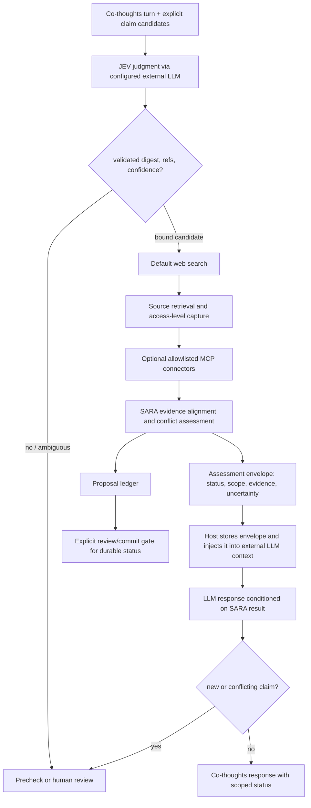

# SARA v3 통합 설계 기준

- **상태:** v3 구현 후보 — 로컬 구현 완료, release gate 및 canonical 승격 대기
- **검토일:** 2026-10-25
- **현재 기준선:** v2.4 canonical; v2.5 operational trial
- **로컬 검증:** Python 3.13.9 / pytest 8.4.2, 전체 suite 453 passed (2026-10-25); live/host/release gate는 미검증
- **목적:** 버전별로 분리된 실행·판단·출처 확인 경로를 외부 LLM 및 Co-thoughts와 연결하는 v3 기준을 정의한다.

이 문서는 설계 결정과 구현 기준을 기록한다. 저장소의 v3 후보 코드가 있어도 live provider 연결, 운영 보안 검토, 성능 검증 또는 canonical 승격을 완료했다는 뜻은 아니다.

## 1. v3의 목표와 사용자 의도

v3는 SARA를 특정 생성형 모델에 종속시키지 않는다. 외부 LLM(OpenAI, Anthropic, Gemini, Kimi 등)이 SARA의 버전 관리된 JEV 판단 기준을 수행하는 모델 실행기로 동작하고, SARA는 판단·출처 검증 결과를 구조화한다. 그 결과를 Co-thoughts와 후속 외부 LLM 호출에 검증된 맥락으로 돌려준다.

외부 LLM이 SARA 결과를 “수용”한다는 것은 결과를 SARA가 발행한 상태와 근거로 대화 맥락에 포함해 응답을 조정한다는 뜻이다. LLM의 지시 준수만으로 보장하지 않는다. 호스트가 SARA 결과를 별도 구조화 상태로 보존하고, 후속 요청에 주입하며, 응답에서 상태가 임의로 승격·변경되지 않도록 확인한다.

## 2. 저장소 점검에서 확인한 현황

| 영역 | 확인된 구현·문서 | v3 영향 |
|---|---|---|
| 기본 실행 | 루트 `sara_runtime.py`가 v2.3 `SARAExecutor`/`ProductionVerificationBackend` 계약을 사용한다. | v2.3 실행 형식은 호환 facade로 격리하고, v3 내부 계약을 별도로 둔다. |
| v2.4 | 인식론 상태, 출처 귀속 제약, 명시적 argument graph 구조 감사를 추가한다. 자유 형식 문장을 자동 분석하지 않는다. | v2.4 의미와 회귀 기준을 보존하되, 구조 검사 결과를 사실 검증으로 합치지 않는다. |
| v2.5 JEV | 버전 관리된 rubric, 입력 digest, inference 상태·유형·근거 span·candidate ID 바인딩과 trigger/precheck 경로가 있다. | JEV 판단 기준과 출력 계약을 재사용한다. 다시 정의하거나 provider 출력 자체를 진실 판정으로 취급하지 않는다. |
| JEV 입력 경계 | 현재 dialogue runtime은 명시적으로 제공된 `claim_candidates`에서 결과가 가리키는 ID를 확인한다. | Co-thoughts 호스트의 claim 후보 제공과 ID 연결을 v3 통합 계약에 포함한다. 후보 생성 범위가 추가되면 별도 parity 검토를 거친다. |
| LLM adapter | 현재 코드의 generic HTTP adapter는 OpenAI, Anthropic, Gemini, OpenAI-compatible 경로를 다룬다. 저장소 상태 문서는 stub 기반이라고 명시한다. | capability-based adapter registry를 둔다. Kimi 및 추가 모델은 API/출력 제약을 확인한 뒤 전용 또는 호환 adapter로 등록한다. 현재 연결된 것으로 간주하지 않는다. |
| 출처 확인 | v2.3 Crossref content accessor는 제공 URL의 콘텐츠 접근 기능이며, 범용 웹 검색기는 아니다. Production backend는 A2 pipeline을 주입하지 않은 경우 성공 provider의 `verification_status`를 그대로 사용할 수 있다. 루트 실행 경로는 A2 pipeline을 주입하지 않는다. | 검색/MCP provider는 최종 verification status를 정하지 못하게 한다. v3 SARA assessment가 검증 가능한 source/evidence 자료를 받아 자체 계약으로 proposal을 만든다. |
| 상태 커밋 | v2.5 verification proposal과 human-review commit gate가 분리되어 있다. | 현재 turn에서 proposal을 LLM 맥락으로 전달할 수는 있지만, 영속 상태의 확정은 기존 명시적 검토/commit 계약을 따른다. |
| 지속성·평가 | provenance ledger는 prototype이고 durable 운영 저장소, live host/provider 연결, 독립 adjudication은 미확인이다. | 출시 조건으로 저장소·접근 제어·실제 provider 연결·독립 평가 증거를 요구한다. |

따라서 현재 저장소는 “v2.3 기본 + v2.4 검사 + v2.5 판단 경로”가 함께 있는 상태이며, v3 단일 통합 계약은 아직 없다.

## 3. 확정할 핵심 설계 결정

### D1. JEV 판단 기준은 v2.5 계약을 계승한다

v3는 기존 JEV rubric의 추론 존재/유형 판단, 근거 span, 불확실성, 명시 claim ID 바인딩, digest 검증, 애매함의 precheck 라우팅을 기준선으로 삼는다. v3에서 바뀌는 것은 모델 공급 및 host 연동 추상화이며, JEV 판정 기준의 의미 변경은 별도 버전과 비교 평가 없이 하지 않는다.

현재 코드가 받는 candidate catalog를 Co-thoughts가 어떤 단계에서 만들고 연결하는지는 실제 host 연동 검토 때 확인한다. v3는 후보 ID가 없거나 본문과 binding이 맞지 않으면 자동으로 대상을 추측하지 않고 `REVIEW_REQUIRED`로 보낸다.

### D2. Judgment LLM과 source verification은 분리된 역할이다

- **Judgment model provider:** 외부 LLM에 SARA의 JEV rubric과 구조화 입력을 전달하고, 제한된 judgment schema를 받는다. 역할·모델·버전·rubric 버전을 결과에 기록한다.
- **Source retrieval provider:** 기본 웹 검색 connector가 검색 결과와 원문 접근을 제공한다. 이 provider는 자료를 찾고 가져오며, 검색 성공만으로 claim 상태를 확정하지 않는다.
- **MCP connectors:** 사용자가 허용한 서버·도구만 allowlist로 추가한다. 웹 검색 기본 경로를 대체하지 않으며, 특정 MCP 서버가 존재한다는 사실만으로 신뢰하지 않는다.
- **SARA assessment layer:** v2.4/v2.5의 상태·provenance·conflict·revision 원칙을 통합해 evidence-to-claim 관계와 불확실성을 구조화한다. JEV 판단은 지정한 외부 LLM이 수행하지만 source evidence와 분리해 기록한다. **SARA가 발행한 claim revision-bound assessment는 후속 외부 LLM이 해당 대화의 검증 결과로 수용하도록 구조화 입력에 포함하고, 응답은 그 claim ID를 모두 명시적으로 참조해야 한다.** 후속 LLM 응답은 assessment envelope을 덮어쓰거나 승격할 권한이 없다. source provider가 보낸 최종 `verification_status`는 입력으로 받거나 권위 있는 상태로 통과시키지 않는다.

Judgment LLM과 Co-thoughts의 대화 생성 LLM은 같은 모델일 수도 다른 모델일 수도 있다. 이 경우에도 `provider_role`을 분리해 기록하고, 가능하면 독립된 검토 모델 사용을 설정으로 선택할 수 있게 한다. 다중 모델 합의는 자동 검증 또는 다수결로 승격하지 않는다.

### D3. SARA 결과는 외부 LLM으로 되돌려 보낸다

SARA 결과는 prompt에만 덧붙이지 않고, 호스트가 상태로 보존하는 **assessment envelope**로 전달한다. 최소 필드는 다음과 같다.

```json
{
  "schema_version": "sara.assessment.v3",
  "claim_id": "C-123",
  "claim_revision_id": "R-4",
  "claim_digest": "sha256:...",
  "verification_status": "PARTIALLY_VERIFIED",
  "workflow_status": "PROPOSED",
  "scope": {"time_range": "...", "population": "..."},
  "evidence_refs": ["E-1", "E-2"],
  "checked_at": "...",
  "uncertainty": ["PRIMARY_TEXT_NOT_ACCESSED"],
  "verifier_revision": "...",
  "verification_contract_revision": "..."
}
```

후속 LLM은 이 envelope을 SARA가 발행한 해당 claim revision의 검증 결과로 받아들이고 응답에서 모든 관련 claim ID를 참조한다. 응답이 상태와 다르게 주장하거나 새 사실을 추가하면 그 응답이 상태를 덮어쓰지 못하게 하고, claim revision 변경 또는 새 근거가 확인될 때 재검증을 요청한다. 모델이 envelope을 따르지 않는 경우를 prompt 조정만으로 해결했다고 간주하지 않는다.

`PROPOSED` 결과는 제안 상태임을 명시해 전달한다. 지속 ledger에 확정 상태로 반영할 때는 v2.5의 reviewer-bound commit gate를 유지한다. `VERIFIED`는 지정된 claim·scope·evidence·시점에서 검증 절차가 지지 근거를 확인했다는 의미이지, 보편적·영구적 진실 보증이 아니다.

### D4. 웹 검색 기본, 원문 확인은 별도 단계

기본 순서는 claim 후보 → 검색어/검색 호출 → 출처 후보 기록 → 가능한 경우 원문/공식 자료 접근 → 근거 구절 추출 → 주장과 근거의 관계 평가 → 상태 제안이다. 검색 API와 웹 검색 공급자는 adapter 뒤에 두어 교체할 수 있게 한다.

각 evidence에는 URL/식별자, 발행 주체, 게시·수정일(확인 가능할 때), 조회 시각, 출처 유형, 원문 접근 수준, 인용 span, 콘텐츠 digest, claim과의 관계, provenance를 기록한다. 접근 수준은 최소한 `SEARCH_SNIPPET`, `METADATA`, `ABSTRACT`, `FULL_TEXT`, `UNAVAILABLE`을 구분한다.

현행 v2.3 `CitationFitEvaluator`는 claim 전체 문자열의 콘텐츠 내 존재 여부를 검사한다. 이는 literal citation-fit 신호이며, 동의어·요약·수치 범위·인과 강도 등을 포함한 의미적 support 검증은 아니다. v3는 `LITERAL_MATCH`와 `SEMANTIC_RELATION`을 별도 결과로 둔다. 의미 관계 평가를 사용할 때 평가 모델은 claim revision과 추출된 source span에 바인딩된 `SUPPORTS`, `CHALLENGES`, `MIXED`, `IRRELEVANT`, `INSUFFICIENT` 제안 및 rationale/span을 반환한다. SARA는 span과 참조를 검증하고, 실행 실패·근거 없는 제안·스코프 불일치는 `UNVERIFIED`/review로 처리한다. 최종 proposal과 reviewer-bound durable commit은 분리한다.

- 검색 snippet·검색 요약·DOI/서지정보만으로 `VERIFIED`를 부여하지 않는다.
- 원문 접근이 막히면 확인한 범위를 명시하고 보수적으로 `UNVERIFIED` 또는 `PARTIALLY_VERIFIED`를 제안한다.
- 1차 출처와 공식 자료를 우선하고, 출처 독립성·범위·시간이 다른 자료를 같은 근거로 뭉개지 않는다.
- 지지와 반박 근거가 함께 있으면 v2.5 conflict 상태를 유지하고, 단순 다수결로 결론내리지 않는다.
- 웹 검색 실패, MCP 실패, timeout은 부정 증거가 아니라 `NOT_ASSESSED`/`UNVERIFIED`와 오류 코드로 기록한다.

### D5. 외부 콘텐츠와 도구 호출은 불신 경계에 둔다

검색 페이지·문서·MCP 응답·외부 LLM 출력은 모두 분석 데이터다. 그 안에 포함된 지시문은 실행 지시로 취급하지 않는다. LLM이 임의의 MCP 도구를 선택·호출하게 하지 않고, SARA orchestrator가 권한·입력 스키마·호출 횟수·시간 제한을 검증한 뒤 허용된 tool만 호출한다.

기본 MCP 권한은 read-only와 최소 범위로 둔다. 도구별 서버 식별자, 허용 작업, 인증 주체, 응답 provenance를 남기며, 외부 쓰기·상태 변경 tool은 별도 명시 허용 전까지 지원 범위에서 제외한다. API key는 환경/secret store에서만 읽고 요청·로그·ledger에 저장하지 않는다. 대화/claim을 외부 모델·검색·MCP로 보내는 범위, redaction, retention은 host 설정으로 통제한다.

### D6. 상태·staleness·실패를 분리해 보존한다

v3 출력에서 아래를 단일 점수/boolean으로 합치지 않는다.

- JEV judgment 상태와 실행 상태
- source/evidence 접근 상태
- evidence-to-claim alignment 및 conflict 상태
- claim verification proposal/committed 상태
- logical audit 및 evaluator 신호
- truthfulness 상태
- provider/tool 실행 상태

claim text/scope, evidence digest, JEV rubric, verifier, schema/contract revision이 달라지면 기존 결과는 자동 재사용하지 않고 stale/reverification 경로로 보낸다. timeout·rate limit·부분 장애 시 bounded retry와 deadline을 적용하고, 미확정 외부 호출을 성공이나 실패로 추정하지 않는다. 임의의 tool 결과로 이전 검증 상태를 덮어쓰지 않는다.

## 4. 주요 예상 이슈와 설계상 처리

| 예상 이슈 | v3 해결 방안 | 확인 증거 |
|---|---|---|
| source provider가 자기 `verification_status`를 성공 결과에 넣어 SARA 상태가 됨 | provider는 검색 결과·원문·접근 범위·provenance만 반환. SARA assessment 계층만 status proposal을 산출하며 schema validator가 provider status 필드를 거부한다. | source provider의 임의 `VERIFIED` 주입, A2 미구성, retrieval 성공/실패 경로 상태 전이 계약 확인 |
| literal citation match가 의미적 사실 검증으로 오해됨 | exact text fit과 semantic support를 별도 dimension으로 저장. 의미 평가는 source span에 바인딩된 structured proposal로만 기록하고 별도 status/commit gate를 통과시킨다. | paraphrase, negation, qualifier, quantity, causality, mixed-evidence 사례를 독립 adjudicate |
| 외부 LLM이 SARA의 상태를 무시하거나 바꿔 말함 | Assessment envelope을 host가 보존하고 매 호출에 주입. 출력 상태 변경/새 주장 탐지 시 재검증 또는 review queue. | 실제 Co-thoughts 대화 loop 통합 사례 및 무시·충돌 테스트 |
| JEV 결과가 사실 판정으로 오해됨 | JEV judgment schema와 source verification schema를 분리하고, judgment는 `is_evidence=false`, `claim_truth_assessed=false`를 유지. | v2.5 계약 회귀 및 serialization 검사 |
| claim 분해 또는 ID binding 누락 | v2.5 JEV 기준 유지, Co-thoughts가 명시 후보와 ID를 공급; 불명확/불일치 시 자동 추측 대신 precheck. | host 입력 contract와 binding/stale digest 통합 확인 |
| 검색 snippet/초록을 원문 검토로 오인 | 접근 수준과 근거 span을 필수 기록; `SEARCH_SNIPPET` 단독으로 VERIFIED 금지. | 출처 범위별 독립 adjudication 사례 |
| 서로 다른 시기·모집단의 출처가 충돌 | claim scope, time, population을 비교하고 v2.5 conflict 상태로 분리; majority vote 금지. | 같은 주장에 대해 scope/time이 다른 conflict fixture와 adjudication |
| 웹/MCP prompt injection 또는 과도한 권한 | tool allowlist, read-only 기본, schema validation, 콘텐츠/지시 분리, bounded egress와 redaction. | 악성 페이지/MCP 응답, 권한·secret 노출 회귀 점검 |
| 다수 모델 합의가 증거처럼 취급됨 | 합의는 선택적 evaluator signal일 뿐; source evidence나 committed status로 승격 금지. | 모델 장애/불일치 테스트와 상태 전이 검증 |
| provider별 schema 미지원·응답 차이 | capability 기반 adapter, 공통 JSON contract validator, 미지원 schema capability는 사전 실패/대체 경로. | adapter별 contract test와 실제 provider smoke evidence |
| 비용·지연·속도 제한 및 부분 장애 | 요청별 deadline/호출 예산, bounded retry, optional cache keyed by claim/evidence/revision digest, 공개용 안정 error code. | latency/cost 측정과 timeout/rate-limit/live integration 결과 |
| 외부 전송에 따른 개인정보·저작권·보존 문제 | 데이터 최소화, host 수준 provider별 허용정책/보존정책, 출처별 접근·인용 범위 기록. | 배포 설정과 data-flow/security review; 저장소 코드만으로 확인 불가 |
| provenance ledger의 내구성·재현성 부족 | 저장소 adapter를 분리하고 event append, revision/digest binding, access control, backup/replay 요구사항을 운영 설계로 확정. | 실제 persistence, tamper, recovery, duplicate/replay 통합 증거 |

## 5. v3 논리 흐름



구현 후보는 이 경로를 실행하지만, 실제 provider와 Co-thoughts host에서 동작한다는 운영 증거는 아직 없다.

## 6. 통합 및 마이그레이션

1. **기준 보존:** v2.4 canonical 동작을 regression suite로 고정하고, 정확한 기준 commit과 변경 가능한 maintained tree를 구분한다.
2. **계약 통합:** v2.3 실행 envelope, v2.4 epistemic/attribution/logical audit, v2.5 JEV/claim identity/conflict/provenance/commit gate를 버전된 v3 schema로 매핑한다. 과거 module을 단순 import해 v3라고 부르지 않는다.
3. **provider interface:** judgment LLM, web search, page fetch/content access, MCP connector를 별도 interface와 공통 error/provenance 계약으로 등록한다.
4. **host 연결:** Co-thoughts가 claim candidates와 context를 제출하고 SARA assessment envelope을 받아 다음 LLM 호출에 넣는 왕복 통합을 구현한다. API key와 credentials는 host에서 주입한다.
5. **호환 기간:** v2.3/v2.4/v2.5 진입점을 deprecated compatibility facade로 유지하고, 출력에 `schema_version`, `runtime_revision`, 원천 assessment를 명시한다.
6. **승격:** 아래 release gate가 충족되고 명시적 human approval을 받은 뒤에만 v3를 canonical로 선언한다. 구현 완료, local green tests, synthetic provider 실행만으로 승격하지 않는다.

## 7. v3 출시 전 수용 기준

- JEV rubric 및 v2.5 binding/staleness/failure 계약에 대한 회귀 비교가 통과한다.
- 지원한다고 표시한 각 judgment adapter에서 실제 API 형식과 structured output 제약을 확인한다. stub 기반 결과는 live 연동 증거와 분리한다.
- 기본 웹 검색에서 snippet-only, metadata-only, abstract, full-text, unavailable 케이스를 각각 검증한다. snippet-only가 `VERIFIED`가 될 수 없음을 확인한다.
- source/MCP provider가 임의의 `VERIFIED`를 반환해도 상태가 승격되지 않으며, retrieval, literal citation fit, semantic relation, SARA proposal, reviewer commit이 서로 분리됨을 확인한다.
- MCP 도구 allowlist, read-only 기본권한, timeout, malformed response, prompt injection, secret redaction을 확인한다.
- SARA 결과가 Co-thoughts host를 통해 외부 LLM 호출에 전달되고, 후속 LLM이 결과를 무시·오염한 경우 상태가 승격되지 않는 live host integration evidence를 확보한다.
- source verification 판단과 reviewer-bound durable commit이 구분되고, conflict·stale revision·partial failure가 fail-closed임을 검증한다.
- 독립 adjudication이 된 benchmark와 사전 지정된 false-positive/false-negative/abstention/latency/cost 기준으로 비교 평가한다.
- 영속 저장·접근 통제·보존·복구·감사 요구사항을 실제 배포 환경에서 확인한다.
- 모든 증거는 정확한 candidate commit에 묶고, 미충족 gate는 `UNVERIFIED` 또는 `BLOCKED`로 남긴다.

## 8. 미확정 배포 선택

아래 항목은 설계 원칙을 바꾸지 않는 배포 선택이며, 실제 provider/host 환경을 확인한 뒤 정한다.

- 기본 웹 검색 서비스와 사용 약관/지역/데이터 보존 조건
- Kimi 및 추가 LLM의 전용 adapter 지원 여부와 현재 API/schema capability
- MCP server 목록, 인증 방식, 허용 tool, rate limit
- host가 제공하는 durable ledger와 reviewer identity/authorization
- 모델/검색 호출에 전송 가능한 대화 범위와 retention 설정
- 배포별 latency·비용 한도와 retry budget

이 선택들이 정해지기 전에는 v3의 provider API 연결, live 검증 품질, 개인정보 처리 적합성, production readiness를 확인했다고 표시하지 않는다.
